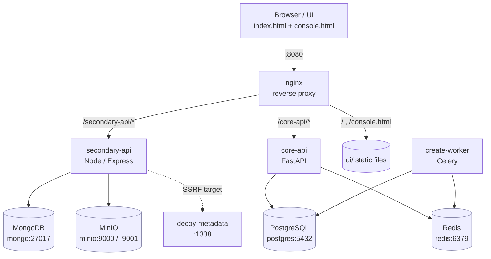
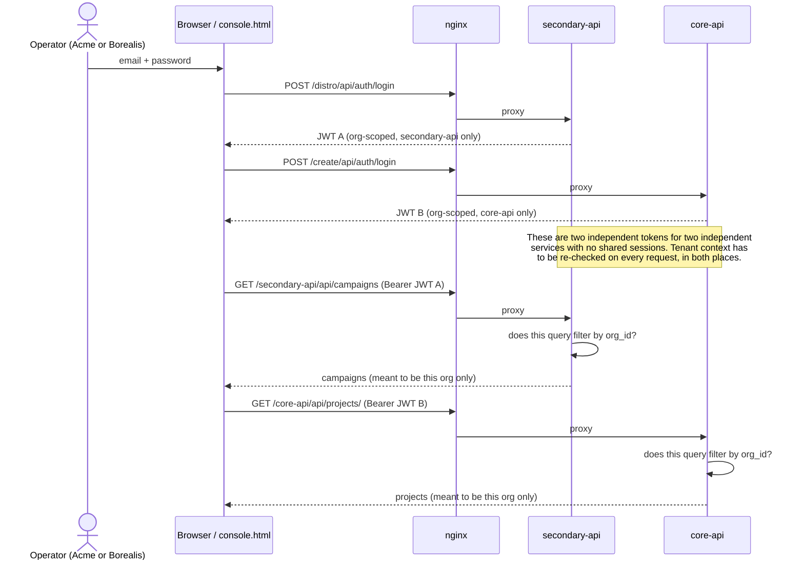

# TenantSheep.

A deliberately vulnerable, two-service SaaS application built as a practice
target for multi-tenant penetration testing. Rather than a collection of
unrelated CWEs, TenantSheep models the architectural split you actually
encounter in real two-stack SaaS products: a document-oriented Node service
and a relational Python service, sharing tenants, fronted by a reverse
proxy, with object storage and an async task queue in the mix.

**16 deliberate vulnerabilities** span authentication, authorization, input
handling, tenant isolation and infrastructure configuration, plus a set of
stretch items for deeper exploration.

> **This is an intentionally insecure application.** Every vulnerability is
> by design. See [Safety](#safety) before running it anywhere.

---

## Contents

- [Architecture](#architecture)
- [Quickstart](#quickstart)
- [Services](#services)
- [Seeded logins](#seeded-logins)
- [Challenges](#challenges)
- [Staging vs. production posture](#staging-vs-production-posture)
- [What's verified vs. not](#whats-verified-vs-not)
- [Safety](#safety)
- [Repository layout](#repository-layout)

---


## Architecture




### Auth flow

Each service issues and checks its own JWT independently with no
shared session in-between.



| Service | Stack | Responsibility |
|---|---|---|
| **secondary-api** | Node · Express · Mongoose · MongoDB | Campaigns, profiles, assets, team invites, storage |
| **core-api** | FastAPI · SQLAlchemy · PostgreSQL · Celery · Redis | Projects, authentication, async export tasks |
| **nginx** | nginx 1.27 | Reverse proxy for both APIs; serves the web UI |
| **MinIO** | S3-compatible object storage | Presigned upload/download URLs |
| **decoy-metadata** | Node | Fake cloud metadata endpoint — SSRF target, fake data only |

Both APIs share the same two tenants (Acme Media and Borealis Co), which is
what makes cross-tenant isolation the central theme of the challenge set.

---

## Quickstart

```bash
docker compose up --build -d
docker compose exec secondary-api node seed.js
docker compose exec core-api python seed.py
```

Then open **<http://localhost:8080>** in your browser and log in with one of
the [seeded accounts](#seeded-logins).

To tear everything down, including volumes:

```bash
docker compose down -v
```

---

## Services

| Service | URL | Notes |
|---|---|---|
| **Web UI** | <http://localhost:8080> | Application front-end, served at `/` |
| **API console** | <http://localhost:8080/console.html> | Raw request console, with a form for pasting forged JWTs |
| **distro-api** | <http://localhost:8080/distro/> · direct on <http://localhost:4000> | Node / Express |
| **create-api** | <http://localhost:8080/create/> · direct on <http://localhost:8000> | FastAPI; interactive docs at `/create/docs` |
| **MinIO console** | <http://localhost:9001> | `tenantsheep` / `tenantsheep123` |
| **decoy-metadata** | <http://localhost:1338> | SSRF target — fake data only |

nginx fronts both APIs under `/secondary-api/` and `/core-api/` and serves the UI at
`/` and `/console.html`. The API console is the most convenient way to drive
the backends directly, including with hand-forged tokens.

---

## Seeded logins

Both services share the same two tenant accounts.

| Email | Password | Org |
|---|---|---|
| `alice@acme.test` | `Password123!` | Acme Media |
| `bob@borealis.test` | `Password123!` | Borealis Co |

---

## Challenges

[`CHALLENGES.md`](https://github.com/TheVoidThatConsumes/TenantSheep/blob/c1fac38cc76948dec4baa5c31ea26593cd90f465/tenantsheep%20/CHALLENGES.md) lists every vulnerability without
spoilers, grouped by service. [`SOLUTIONS.md`](https://github.com/TheVoidThatConsumes/TenantSheep/blob/c1fac38cc76948dec4baa5c31ea26593cd90f465/tenantsheep%20/SOLUTIONS.md) contains full
walkthroughs.

Read `CHALLENGES.md` first. Reach for `SOLUTIONS.md` when you're stuck or
short on time, not on your first attempt.

The set covers:

- **secondary-api** — cross-tenant search, IDOR, a legacy route with broken
  token handling, SSRF, and path traversal.
- **core-api** — SQL injection, a missing-auth route, mass assignment,
  Celery task injection, a cross-tenant cache leak, and a structural
  tenant-isolation exercise.
- **Infrastructure** — a deliberate omission in `nginx.conf` relevant to
  request smuggling. Spot it by reading the config; live exploitation is
  not guaranteed to be reliable against this exact setup.
- **Stretch items** — email recipient and header abuse, HTML template
  injection, profile privilege escalation, Host-header tenant enumeration,
  presigned-URL scoping, and a staging/production `DEBUG` drift comparison.

---

## Staging vs. production posture

`core-api` exposes a `DEBUG` flag that toggles between a staging-like and
a production-like posture. To compare the two, set `DEBUG: "false"` for the
`core-api` service in `docker-compose.yml` and restart it:

```bash
docker compose up -d --build core-api
```

Several behaviors change at once when the flag flips. Comparing them is
itself one of the challenges.

---

## What's verified vs. not

Both services were functionally tested during development, but to different
degrees:

- **core-api** — the full HTTP flow (login, the SQL injection, the
  missing-auth route, and mass assignment) was exercised end-to-end against
  a live SQLite database, and the Celery task's missing-tenant-check logic
  was confirmed directly.
- **secondary-api** — dependencies install cleanly and every file passes a
  syntax check, but it could not be run end-to-end against a live MongoDB in
  the environment it was built in. That service gets its first real run when
  you bring up `docker compose` yourself. If something doesn't behave as
  described, that's the most likely place to look first.

---

## Safety

Every vulnerability here is intentional. All secrets, tokens, and credentials
are decoys. Nothing real is present anywhere in this repository.

**Do not deploy this application anywhere reachable from the internet.** Do
not point any part of it at real infrastructure, real credentials, or systems
you do not own or have explicit permission to test.

---

## Repository layout

```
.
├── CHALLENGES.md          # vulnerability list — no spoilers
├── SOLUTIONS.md           # full walkthroughs (do not publish)
├── README.md
├── docker-compose.yml
├── core-api/            # FastAPI service
├── secondary-api/            # Node / Express service
├── decoy-metadata/        # fake metadata endpoint (SSRF target)
├── nginx/
│   └── nginx.conf         # reverse proxy config (contains the infra omission)
└── ui/                    # web UI and API console, served by nginx
```

---

*TenantSheep is a training lab. It is not affiliated with, endorsed by, or
derived from any commercial product.*
